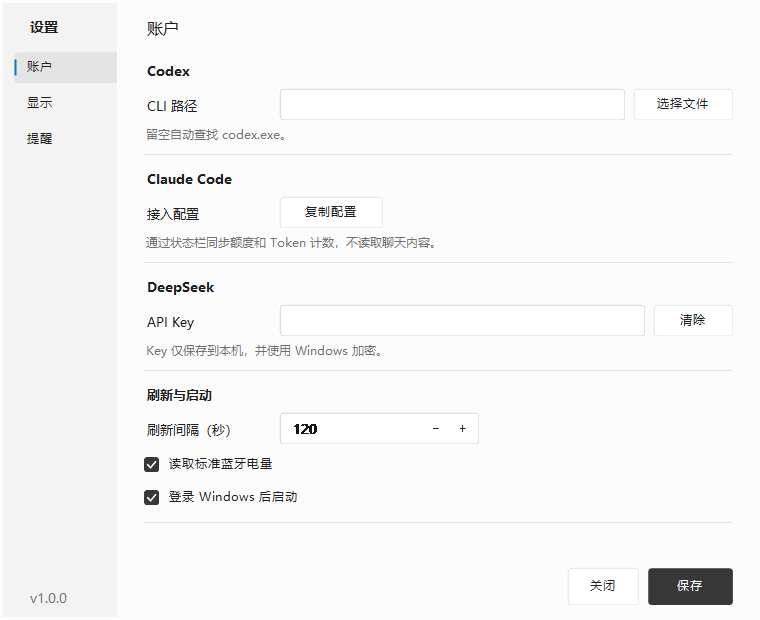

# TokenDock

在 Windows 任务栏查看 AI 额度、API 余额和设备电量。

TokenDock 将常用信息直接显示在任务栏中。鼠标悬停查看详情，单击打开面板；未接入或没有有效数据的项目自动隐藏。


## 功能

- **任务栏显示**：应用 Logo、额度百分比、余额和设备电量；支持名称模式与紧凑模式。
- **位置与排序**：自动寻找空位、靠左、靠右或拖动定位；可调整项目顺序、锁定位置以防误拖。
- **悬停速览**：查看各周期剩余额度、重置倒计时，以及电量来源和更新时间。
- **提醒**：设置低额度、低余额、低电量阈值；额度周期更新或从低位恢复时也可通知。
- **本机历史**：查看最近 24 小时、7 天、30 天的额度、余额和电量变化，可暂停记录。
- **设备电量**：读取 Windows 上报或标准 BLE 电量；另提供有限的 FLX1 2.4G 接收器适配。

锁定位置只阻止鼠标拖动，仍允许在设置或右键菜单中主动切换位置。真实的 `0%` 和零余额不会因数值为零而隐藏。


## 数据支持范围

| 来源 | 可显示的数据 | 接入方式与限制 |
| --- | --- | --- |
| Codex | 套餐额度、重置时间；CLI 提供时显示账户累计 Token | 使用本机已安装并登录的 Codex CLI，缺少的字段不估算 |
| Claude Code | 状态栏提供的套餐额度、最近会话输入与输出 Token | 需要配置状态栏桥接，并在会话中产生响应；未提供额度字段时无法显示套餐余量 |
| DeepSeek API | API 账户可用余额，按返回币种显示 | 需要 DeepSeek API Key；不将余额换算成固定的剩余 Token |
| 蓝牙设备 | Windows 上报或标准 BLE 服务提供的电量百分比 | 取决于设备、固件及 Windows 驱动，不保证所有鼠标、键盘和耳机都能读取 |
| FLX1 2.4G | 厂商上报的电量、充电状态 | 仅验证了特定接收器与固件，需要本机绑定；不代表其他 FLX1 版本或蓝牙模式受支持 |

**套餐额度、账户累计 Token 和会话 Token 是不同指标。** TokenDock 不会将额度百分比推算成剩余 Token，也没有接入 OpenAI / Anthropic API 账户的完整账单统计。

## 界面



图片为实际程序控件生成的界面示意，数值和账户配置使用演示数据。

## 系统要求

- Windows 11，64 位：已在本机验证任务栏显示和设备读取。
- Windows 10 22H2，64 位：兼容目标，尚未完成实机验证。
- .NET Framework 4.8。
- Windows PowerShell 5.1：用于蓝牙设备读取。
- 使用 Windows Explorer 的主屏横向任务栏。

当前不支持竖向任务栏，副屏任务栏及多显示器场景尚未完成验证。任务栏嵌入依赖 Explorer 窗口结构，系统更新或第三方任务栏可能影响显示。

## 下载与运行

1. 从本仓库的 [Releases](https://github.com/loongzcode/TokenDock/releases) 页面下载 `TokenDock-1.0.0.zip`。
2. 将压缩包完整解压到一个固定目录，保留所有文件。
3. 运行 `TokenDock.exe`，从系统托盘打开设置。
4. 在“账户”中接入服务，在“显示”中选择常驻项目。

首次运行时，没有有效数据的项目不会出现在任务栏中。可先通过托盘检查账户与设备状态。

当前构建尚未完成可信代码签名，部分 Windows 安全策略可能阻止运行。修改版本号或更换文件名不能解决签名限制。

## 接入服务

### Codex

使用本机已登录的 Codex CLI。在“设置 → 账户”中填写 `codex.exe` 路径；留空时程序会尝试自动查找。

可选择自动额度、短期额度、周额度、最紧张额度或账户累计 Token。可选项能否显示取决于 CLI 实际返回的数据。

### Claude Code

1. 打开“设置 → 账户”，找到 Claude Code，点击“复制配置”。
2. 将生成的 `statusLine` 配置合并到 Claude Code 设置中。
3. 继续使用 Claude Code，在会话产生响应后回到 TokenDock 刷新。

桥接只保留额度与 Token 计数字段。快照超过 10 分钟未更新时会标为旧数据；需要继续使用 Claude Code 才能获得新快照。

### DeepSeek

在“设置 → 账户”填写 DeepSeek API Key 并保存。已保存 Key 时，输入框留空会保留原值；“清除”操作需要保存后生效。

### 设备电量

已配对的蓝牙设备会自动扫描。连接变化时会发起设备刷新，并在稍后补读一次；最终显示时间取决于 Windows 和设备上报。

FLX1 接收器适配需要单独绑定，不会仅凭相同 VID/PID 自动启用。读取前后均检查设备状态，避免鼠标关机后显示接收器缓存的电量。充电时显示“充电中”，不把充电期间上报的 `100%` 当作已充满；拔线后固件更新百分比可能有延迟。

设备实测范围、绑定方式和协议限制见 [FLX1 适配说明](docs/FLX1适配说明.txt)。

## 常用操作

| 操作 | 入口 |
| --- | --- |
| 查看用量与电量 | 单击任务栏数据区域或托盘图标 |
| 查看速览 | 鼠标停留在某个项目上 |
| 调整位置 | 直接拖动，或使用右键“位置”菜单 |
| 取消本次拖动 | 按 `Esc`，或远离任务栏释放鼠标 |
| 防止误拖 | 右键勾选“锁定位置” |
| 切换紧凑模式、调整顺序 | 任务栏右键菜单或“设置 → 显示” |
| 查看历史 | 任务栏右键、托盘菜单或详情底部的“历史趋势” |
| 手动刷新 | 详情底部的“刷新”，或在详情窗口按 `F5` |

任务栏没有足够空位时，程序会保留托盘入口，不会改为悬浮在桌面上的常驻条。

## 提醒与历史

默认提醒阈值为：剩余额度 `10%`、设备电量 `20%`、人民币余额 `5 CNY`、美元余额 `1 USD`，均可修改或关闭。

同一次运行中，同一低位状态只提醒一次；恢复后再次降低才重新提醒。额度恢复通知需要先后两次成功读取，首次启动不会仅凭当前额度补发通知。Windows 的通知和勿扰设置可能影响展示。

历史从启用记录时开始积累，不补造过去的数据。数值变化时记录；未变化时最多每五分钟保留一次成功读取的采样。超过 30 分钟没有采样或额度周期变化时，曲线会断线显示。

## 配置与隐私

默认数据目录：

```text
%LOCALAPPDATA%\TokenDock\
├─ settings.json         设置及加密后的 API Key
├─ claude-status.json    Claude 额度与 Token 计数快照
└─ history\              按 UTC 日期保存的指标采样
```

- API Key 使用 Windows 当前用户范围的 DPAPI 加密保存；加密配置不适合作为跨账户通用备份。
- 账户查询会连接相应服务；历史和设置保存在本机。
- 程序不保存聊天内容、提示词或平台原始账户响应。
- 历史只记录指标名称、时间、数值、单位和额度重置时间，默认保留最近 30 个 UTC 日期的文件，写入时清理过期文件。
- 接收器绑定保存哈希指纹，不保存原始序列号。

在程序旁放置空文件 `portable.mode` 可使用便携模式，数据改存于该目录下的 `data/`。升级时先退出旧版，再解压运行新版；默认数据目录会继续沿用。

## 从源码构建

源码采用 C# / WinForms，目标框架为 .NET Framework 4.8。构建脚本使用系统 .NET Framework 编译器；也可使用具备相应开发组件的 Visual Studio 打开 `TokenDock.sln`。

在项目根目录运行：

```powershell
powershell.exe -NoProfile -ExecutionPolicy Bypass -File .\build.ps1
powershell.exe -NoProfile -ExecutionPolicy Bypass -File .\test.ps1
powershell.exe -NoProfile -ExecutionPolicy Bypass -File .\package.ps1
```

这里的执行策略参数仅作用于该 PowerShell 进程，不修改系统策略，也不能绕过应用签名限制。组织管理的设备应遵循其策略。

- `bin/`：构建产物及独立测试程序。
- `dist/`：按程序集版本生成的运行包与源码包。
- `tools/format.ps1`：可选的 C# 格式化工具，需要 PowerShell 7。

当前本地已有 **194 项检查通过**，覆盖数据解析、配置兼容、显示筛选、提醒、历史、布局、锁定、按钮交互及接收器状态校验。自动检查不代替未覆盖设备和系统的实机验证。

## 项目结构

```text
src/
├─ Configuration/   配置、密钥保护与升级迁移
├─ Providers/       Codex、Claude Code、DeepSeek 接入
├─ Bluetooth/       Windows 蓝牙与标准 BLE 电量读取
├─ Devices/         接收器 HID 传输、协议校验与来源合并
├─ Taskbar/         显示项、图标、布局、拖动与速览
├─ Notifications/   提醒判断及通知出口
├─ History/         采样、逐日存储与趋势分段
└─ UI/              设置、详情与历史窗口
tests/              独立回归检查
docs/               使用、架构与设备适配说明
```

更多实现说明见 [架构说明](docs/架构说明.txt)。应用 Logo 的来源及权利说明见 [图标来源](docs/图标来源.txt)。TokenDock 与所展示服务的品牌方无隶属关系。

## 反馈问题

请说明 Windows 版本、TokenDock 版本、连接方式和复现步骤。设备问题请附型号，并说明 Windows 设置或厂商工具能否显示电量。

提交日志或截图前，请移除 API Key、账户信息和其他私人内容，不要上传本机 `settings.json` 或整个数据目录。
